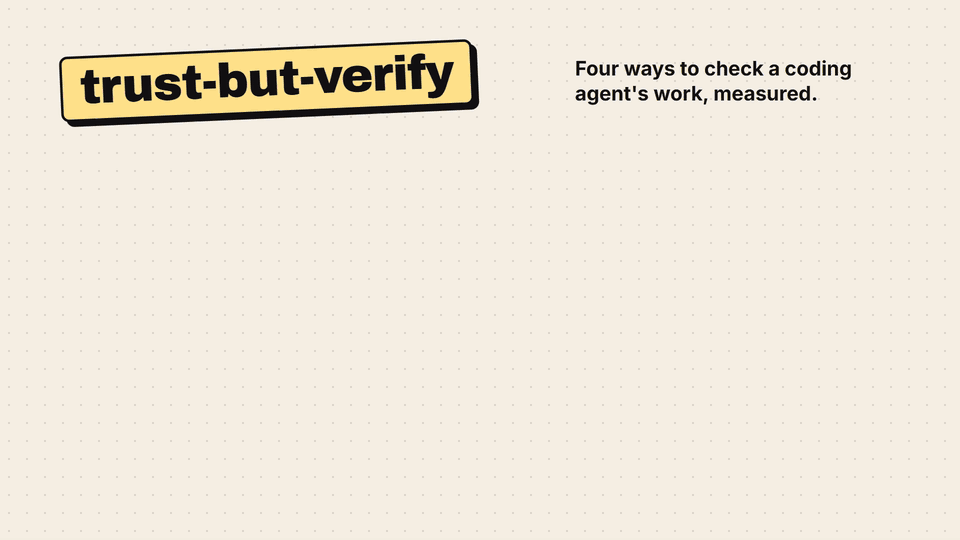
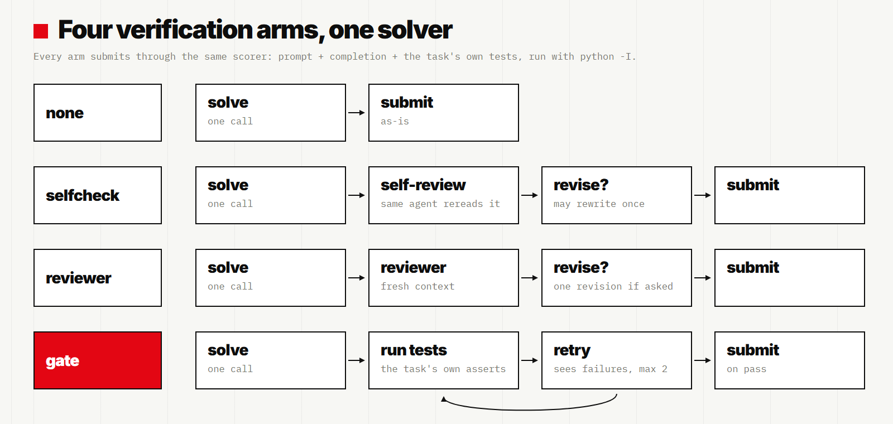
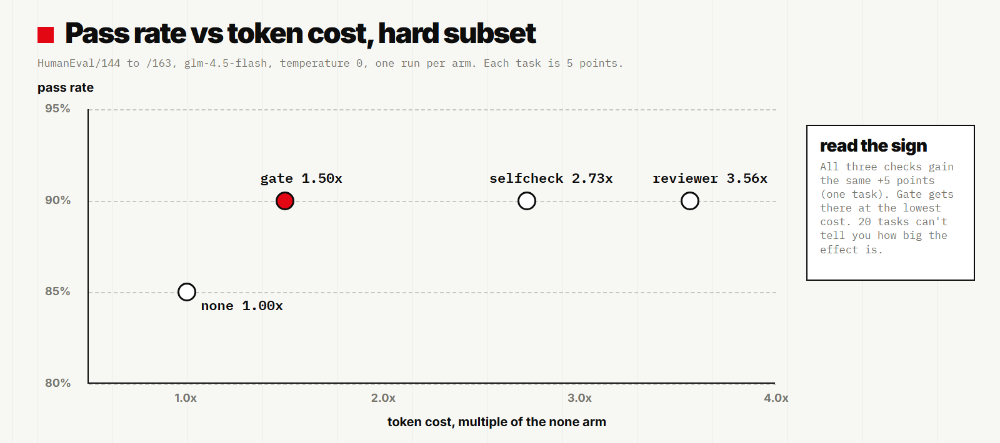

# trust-but-verify

**Four ways to check a coding agent's work before it submits, measured side by side on pass rate and token cost.**


<a href="assets/trust-but-verify.mp4"></a>

<sub>12 s, no sound. Click for the MP4.</sub>

On the hard subset, all three verification designs bought the same +5 pass-rate points. The test gate did it at 1.50x the token cost of no verification; self-checking cost 2.73x and a separate reviewer 3.56x.

| arm | pass rate | avg calls/task | avg tokens/task | cost vs none |
|---|---:|---:|---:|---:|
| none | 85.0% (17/20) | 1.00 | 325 | 1.00x |
| selfcheck | 90.0% (18/20) | 2.00 | 887 | 2.73x |
| reviewer | 90.0% (18/20) | 2.15 | 1155 | 3.56x |
| **gate** | **90.0% (18/20)** | **1.25** | **487** | **1.50x** |

*Formerly `verify-harness`.*

## The four arms



One Python coding agent solves each task. The arms differ only in what happens between the first solution and submission:

| arm | what happens before submission |
|---|---|
| `none` | nothing, the solution goes in as-is |
| `selfcheck` | the same agent instance reviews its own solution once and may revise it |
| `reviewer` | a separate fresh-context call reviews it and may ask for one revision |
| `gate` | the solution runs against the task tests; on failure the agent sees the test output and retries, up to 2 times |

## Results

Measured 2026-11-02. Solver and reviewer are both glm-4.5-flash, temperature 0, thinking disabled, one run per arm. Per-task rows and raw console logs are in the repo (`results/*.csv`, `run_output*.txt`). [RESULTS.md](RESULTS.md) is the source for every number here.



### Hard subset: the last 20 HumanEval tasks (HumanEval/144 to /163)

This is the only measured subset with room below the ceiling, and it's the table at the top of this page. It was chosen after the first-20 subset saturated; DECISIONS.md describes how.

### First 20 HumanEval tasks (HumanEval/0 to /19): saturated

glm-4.5-flash solves all 20 on the first try, so every arm scores 20/20 and verification can't move the pass rate. The cost multipliers still differ, and they're reported as measured.

| arm | pass rate | avg calls/task | avg tokens/task | cost vs none |
|---|---:|---:|---:|---:|
| none | 100.0% (20/20) | 1.00 | 285 | 1.00x |
| selfcheck | 100.0% (20/20) | 2.00 | 769 | 2.70x |
| reviewer | 100.0% (20/20) | 2.00 | 660 | 2.32x |
| gate | 100.0% (20/20) | 1.00 | 284 | 1.00x |

### What the data supports: the sign, not the size

Every delta on the hard subset is exactly one task out of 20, which is 5 points. A subset this small can show a direction but not a magnitude.

- The gate matches the paper on direction and cost range: +5 points at 1.50x here, against the paper's roughly 6 points at 1.5x to 1.8x.
- The reviewer matches the paper's direction (+5 points) but not its cost: 3.56x here, against the paper's 1.13x to 1.25x. The base arm here is one short call, so every verification turn pays for the full context again.
- Selfcheck gained +5 points at 2.73x. That runs against the paper's advice not to self-check at completion time.

## Quickstart

Python 3.11+ with the `openai` and `pytest` packages. The API key comes from the `ZAI_API_KEY` environment variable. The endpoint defaults to `https://api.z.ai/api/paas/v4`; override it with `ZAI_BASE_URL`.

```sh
export ZAI_API_KEY=...
python run.py --arm all                          # all four arms, first 20 tasks
python run.py --arm all --offset 144             # the hard subset above
python run.py --arm all --limit 5                # fewer tasks
python run.py --arm gate                         # one arm
python run.py --arm all --mock                   # deterministic fake solver, no API calls
python run.py --arm all --solver-model MODEL --reviewer-model MODEL
```

Flags: `--arm {none,selfcheck,reviewer,gate,all}`, `--limit N`, `--offset N` (numeric task-id order), `--mock`, `--solver-model`, `--reviewer-model`, plus `--tasks mini` (a bundled 4-task fallback set, no network) and `--csv PATH`. Measured rows go to `results/results.csv` or the `--csv` path, and a full non-mock `--arm all` run also rewrites RESULTS.md. Run the tests with `pytest`.

## Method

- Task set: HumanEval sorted by numeric task id, in fixed 20-task slices picked with `--offset`. The dataset is cached in `data/HumanEval.jsonl`, so reruns need no network.
- Scoring: prompt, completion and the task's own test block are written to a temp file and run as `python -I` in a temp working directory with a 10 s timeout. Exit code 0 is a pass. Every arm goes through the same scoring path.
- Cost accounting: call count, input tokens and output tokens come from the usage fields of each API response (`prompt_tokens`, `completion_tokens`), summed per task and arm, so reviewer tokens count against the reviewer arm. The cost multiplier is the average total tokens per task divided by the none arm's value. Tokens are the cost proxy. The USD figure in RESULTS.md is an estimate from list prices, and a budget guard stops a real run at 80 percent of a 2 USD cap.
- Determinism: temperature 0, thinking disabled, one run per arm, no repeats.

## Limitations

- One model, glm-4.5-flash, which is a flash tier. The paper compared 17 verification designs across 7 frontier models on Terminal-Bench and SWE-bench Verified. This is 4 simplified arms (not ports) on 20 HumanEval function-synthesis problems, scored pass/fail against bundled tests.
- With 20-task subsets, one flipped task moves a pass rate by 5 points, and every delta here is exactly that. Conclusions are about sign only: no repeats, no error bars.
- The first-20 subset saturates for this model, so the hard subset was picked after seeing that.
- The gate arm sees the bundled tests, which rewards fitting those exact asserts.
- HumanEval function synthesis is easier and more self-contained than the agentic benchmarks where the paper found its effects.

## Background

The compared designs and the direction hypotheses come from "Rethinking Verification in Agent Harnesses" (arXiv 2610.34577, Alibaba and Cornell). This repo is a mini replication at a scale where the direction of the paper's findings can be checked but their size can't. It makes no novelty claim.

## Layout

| Path | What it holds |
| --- | --- |
| `run.py` | entry point |
| `src/model.py` | API client, usage tracking, mock client |
| `src/tasks.py` | HumanEval loading, fallback set, test runner |
| `src/arms.py` | the four verification arms |
| `src/report.py` | aggregation, `results.csv`, RESULTS.md |
| `tests/` | pytest suite, no network needed |
| `data/HumanEval.jsonl` | cached task set (MIT, openai/human-eval) |
| `results/` | per-task CSVs for both measured runs and the mock run |
| `run_output*.txt` | raw console logs of the two measured runs |
| `RESULTS.md` | measured numbers, regenerated by full runs |
| `DECISIONS.md` | every non-obvious implementation choice |
| `assets/` | demo video, GIF and diagrams |

## Citation

Source paper:

```bibtex
@misc{rethinkingverification2026,
  title         = {Rethinking Verification in Agent Harnesses},
  author        = {Zhang, Zhengxin and Zhu, Erkang and Lin, Yin and Cardie, Claire and Ding, Bolin and Zhou, Jingren},
  year          = {2026},
  eprint        = {2610.34577},
  archivePrefix = {arXiv},
  url           = {https://arxiv.org/abs/2610.34577}
}
```

This repository:

```bibtex
@misc{trustbutverify2026,
  title  = {trust-but-verify: four verification designs for coding agents, measured},
  author = {Gjusev},
  year   = {2026},
  url    = {https://github.com/Gjusev/trust-but-verify},
  note   = {Mini replication of arXiv 2610.34577}
}
```

## License

MIT, see [LICENSE](LICENSE). The bundled HumanEval data follows its own MIT license (https://github.com/openai/human-eval).
